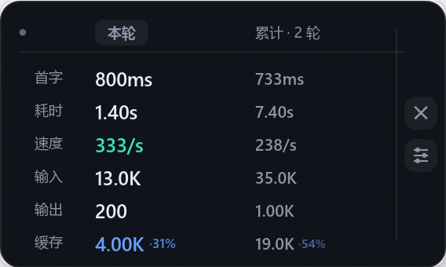

# Tokenbar

**WorkBuddy 的悬浮指标条**：当前任务有多快、花了多少 token，一眼看到。

- **免安装**：Windows 一个 exe，macOS 一个 dmg；不写注册表，不需要管理员权限。
- **本轮 / 累计分开看**：这一句话引起的一轮，和整个任务从头到现在的合计。
- **不打扰**：贴边悬浮，能跟随 WorkBuddy 自动显隐；Windows 版还能自动更新。

Windows 10 / 11 与 macOS 11+ 都有现成安装包。

## 下载

安装包都在 **[Gitee Releases](https://gitee.com/mrpu2020/tokenbar-workbuddy/releases)**
（国内访问更快）。GitHub 上是同样的文件：
**[GitHub Releases](https://github.com/davey2026ch/tokenbar-workbuddy/releases)**，两边 sha256 一致。

**注意**：程序内的自动更新只认 Gitee（见下面「自动更新」）；GitHub 仓库是代码与安装包的镜像，
不参与更新。国内下载慢的时候才用 GitHub 那份。

| 平台 | 文件 | 大小 |
| --- | --- | --- |
| Windows 10 / 11（x64） | `Tokenbar.exe` | 5.48 MiB |
| macOS（Apple 芯片） | `Tokenbar-macos-arm64.dmg` | 2.78 MiB |
| macOS（Intel） | `Tokenbar-macos-x86_64.dmg` | 3.31 MiB |

**Windows**

1. 下载 `Tokenbar.exe`，放进任意文件夹，比如 `C:\Tools\Tokenbar\`。
2. 双击运行，卡片出现在屏幕底部居中（多屏时出现在 WorkBuddy 所在的那块屏幕）。
3. 按住卡片拖到想要的位置，下次打开还在那里。

配置和统计快照写在**当前用户目录 `%APPDATA%\Tokenbar\`**（即
`C:\Users\<你>\AppData\Roaming\Tokenbar\`），不在 exe 旁边——exe 放在 `Program Files`
这种不给写的地方也能正常用，换文件夹、换盘符都不会丢设置：

- `%APPDATA%\Tokenbar\tokenbar.ini` —— 配置（主题、布局、指标顺序与开关、位置）；
- `%APPDATA%\Tokenbar\tokenbar-stats.json` —— 每个任务最后一次看到的累计数字。

想直接打开这个目录：`Win + R` 输入 `%APPDATA%\Tokenbar` 回车（详见「配置文件」）。

> 从旧版本升级：如果 exe 旁边已经有 `tokenbar.ini`，第一次启动会自动复制一份到用户目录
> （老文件留着不动，确认没问题后可以自己删）。

> 如果弹出「Windows 已保护你的电脑」，点「更多信息 → 仍要运行」。原因见「常见问题」。

**macOS**

打开 dmg，把 `Tokenbar` 拖进「应用程序」。按芯片选包，选错了打不开。

首次打开如提示「无法验证开发者」，到「系统设置 → 隐私与安全性」点「仍要打开」。

配置和统计快照写在**当前用户目录 `~/.tokenbar/`**（即 `/Users/<你>/.tokenbar/`），
不在 `.app` 内部——`.app` 是签名过的封套，往里写文件会让签名校验失败；放在用户目录还有个好处：
换新版覆盖 `Tokenbar.app` 时设置不会丢。

- `~/.tokenbar/tokenbar.ini` —— 配置（主题、布局、指标顺序与开关、位置）；
- `~/.tokenbar/tokenbar-stats.json` —— 每个任务最后一次看到的累计数字。

想直接打开这个目录：Finder 里按 `⌘⇧G`，输入 `~/.tokenbar` 回车（详见「配置文件」）。

## 界面

**横排（默认）**：每列一个指标，从上到下是列名、本轮数值、灰色累计值。


*示意图打开了「缓存」列；这一项默认关闭，见下面「指标」。*

**竖排**：一张小卡片，本轮与累计两列对照，适合放在屏幕侧边。



| 操作 | 效果 |
| --- | --- |
| 按住卡片拖动 | 移动位置并记住 |
| 鼠标移到卡片上 | 右侧浮出两个按钮：上面的 ✕ 退出，下面的滑杆按钮打开设置（右键卡片也可以） |
| 在 WorkBuddy 左侧栏切换任务 | 半秒内换成那个任务的数据 |
| 点「新对话」 | 卡片立刻清空，不用等第一句话发出去 |
| 再双击一次 Tokenbar | 卡片被藏起来时叫回来，不会开出第二个 |

左侧圆点是运行状态：流式输出时呼吸闪烁，思考或调用工具时稳定亮青，「耗时」继续走动；
本轮真正结束才变灰。

## 指标

| 指标 | 含义 | 怎么算（数据从哪来） |
| --- | --- | --- |
| 首字 | 首字延迟（TTFT） | 日志 `qua.end` 里的 `ttft_ms`；本轮取这一轮**第一次**有首字的调用，累计取各次调用的平均 |
| 耗时 | 本轮墙钟耗时 | 本轮第一条 `qua.start` → 现在（还在跑时）或最后一条 `qua.end`，**含工具执行**；累计是把每一轮的墙钟时长相加 |
| 速度 | 输出速度 | 输出 token ÷ 纯生成时间；生成时间 = 每次调用的 `total_cost_ms − ttft_ms` 之和，只算已结束的调用 |
| 输入 | 输入 token | 每次调用的 `prompt_tokens` 累加（一轮里模型被叫几次就加几次，是计费量） |
| 输出 | 输出 token | 每次调用的 `completion_tokens` 累加 |
| 缓存 | 缓存命中 | transcript 里每条回复 usage 的缓存读取量，按请求汇总；命中率 = 缓存读 ÷（输入 + 缓存读），最高显示 99.9% |

**缓存这一项默认关闭**：本地模型大多不上报缓存，留着一列「—」反而碍眼。需要就在设置里勾上「缓存命中」。

> 一轮里模型常被调用多次，输入 token 会按每次调用累加——这是实际计费量，不等于「当前上下文有多大」。
> 时间类指标只来自日志；日志里查不到这个任务时改用历史快照或 transcript，此时首字 / 耗时 / 速度显示「—」。

## 取数与刷新节奏

**数字是怎么来的**（只读本机文件，不上传）：

| 优先级 | 来源 | 拿到什么 |
| --- | --- | --- |
| 1 | `~/.workbuddy/logs/<日期>/*.log` 里的 `qua.start` / `qua.end` | 时间类全部指标，最准；回看最近 5 天 |
| 2 | `tokenbar-stats.json`（与 ini 同目录） | 日志过期后的累计值，累计行会标「缓存」 |
| 3 | `~/.workbuddy/projects/**/<会话>.jsonl` 的 usage | 只有输入 / 输出 / 缓存，时间类显示「—」 |
| 4 | 都没有 | 空态「当前任务还没有 Token 记录」 |

**多久取一次、多久变一次**：

| 事情 | 间隔 | 说明 |
| --- | --- | --- |
| 读日志、重算指标 | 最快 **0.25 秒**一次 | 每帧检查，距上次超过 250ms 才真去读；只读文件新增的部分，不整份重扫 |
| 界面重绘 | **0.22 秒**一次（设置窗口开着时 0.09 秒） | 所以眼睛看到的数字大约 0.25～0.45 秒跳一次 |
| 检测切任务（`startup-route.json`） | 跟采集同频 | 在左侧栏换任务，半秒内换到新任务的数字 |
| 判断"在不在跑"（会话状态机日志） | 跟采集同频 | 30 分钟没新状态就不再当作在跑 |
| 前台应用识别（跟随显隐） | **0.5 秒**一次，Windows 与 macOS 相同 | 见下面「跟随显隐」 |
| 统计快照写盘 | 有变化后最多 **每 5 秒**一次 | 正常退出时立刻写 |
| 查更新 | 启动 **3 秒**后一次 | 其余时间不联网 |

「耗时」不是自己累加的：每次都拿"现在 − 这一轮第一次调用开始的时间"现算，所以跑久了也不会漂。

## 设置

点卡片右侧的滑杆按钮，或右键卡片打开。设置是独立窗口，只贴在卡片外侧（上 / 下 / 左 / 右找空位），不会盖住卡片。

改动会立刻反映到卡片上；点「确定」才写入配置，点「取消」或直接关窗口则全部还原。

| 分区 | 内容 |
| --- | --- |
| 外观 | 跟随系统 / 深色 / 浅色 |
| 布局 | 横排（两行）/ 竖排（两列），带缩略图 |
| 行为 | 跟随 WorkBuddy 显示：切到其它应用自动隐身，回来再出现 |
| 指标 | 六行；拖左侧把手排序，点右侧圆点显示 / 隐藏，右上角「恢复默认」 |
| 版本 | 版本号、打包时间、「检测更新」 |
| 底部 | 取消 / 确定 |

## 自动更新

**更新只从 Gitee 取，与 GitHub 无关。** 程序查的是
`https://gitee.com/api/v5/repos/mrpu2020/tokenbar-workbuddy/releases/latest`，
GitHub 上的同名仓库只是代码与安装包的镜像——哪怕 GitHub 版更新得更早，程序也不会去那里拿。


**Windows 版**：

- 每次启动 3 秒后，查一次 Gitee 上的最新 Release（公开接口，不用登录）。
- 有新版本：卡片上方弹出一条提示，点「更新」开始下载并显示进度；下载完先校验是不是 exe、版本号对不对。
- 校验通过后可以点「立即重启」；不点也行——点卡片上的 ✕ 正常退出 Tokenbar，下次打开就是新版。
- 没有新版本或没有网络：不弹任何东西，只在设置窗口的版本区写一行状态。
- 设置窗口里也能手动查：点「检测更新」，发现新版后按钮直接变成「更新」。

替换文件由一个小助手进程在旧程序退出后进行，不会出现「换到一半文件坏了」。

**macOS 版**只做「检测」，不自己换包：

- 启动 3 秒后同样会查一次；设置里点「检测更新」也是真的去查。
- 已经最新 → 写「已经是最新版本」；查到新版 → 写「发现新版本 vX.Y.Z」，按钮变成「去下载」，
  点它用浏览器打开发布页，下新的 dmg 拖进「应用程序」覆盖即可。
- **不会自动替换 `.app`**：macOS 的应用是一个整体包，替换时程序正开着，风险比 Windows 换一个 exe
  大得多，所以这一版没做「退出后自动换包」。
- 卡片上方那条「发现新版本」的浮动提示只对 Windows 弹，macOS 不打断你。
- 手动换包也不会丢东西：证书是固定的，系统授权照旧；配置在 `~/.tokenbar/`，覆盖 `.app` 不影响它。

## 数据来源

Tokenbar 只读本机 WorkBuddy 自己写的文件，**不上传任何数据**。Windows 版只在启动时查一次更新，其余时间不联网。

| 来源 | 用在哪 |
| --- | --- |
| `~/.workbuddy/logs/<日期>/*.log` | 首字、耗时、token、模型名；`sdk/conversations/<会话>.log` 里的状态机决定"在不在跑" |
| `~/.workbuddy/projects/<项目>/<会话>.jsonl` | 输入 / 输出 / 缓存 token（按消息 id 去重） |
| `~/.workbuddy/<用户id>/startup-route.json` | 当前停在哪个任务（`/conversation/<id>` 与 `/task/<id>` 都算会话） |
| `tokenbar-stats.json`（与 ini 同目录） | 日志过期后的累计值 |

取数顺序与刷新间隔见上面「取数与刷新节奏」。老任务切回去也看得到当时的数字。

## 跟随显隐

开启「跟随 WorkBuddy 显示」后：WorkBuddy 在前台时卡片出现，切到别的应用自动隐身，切回来再出现。

Windows 与 macOS **用同一套规则、同一个节奏**——0.5 秒查一次前台应用，两边没有差别。
Tokenbar 自己在设置窗口里时也不会躲。

macOS 判断前台应用走 `lsappinfo`（LaunchServices），不需要「自动化 / 屏幕录制」授权；
万一老系统上退回 AppleScript 又没授权，设置里会提示「未授权「自动化」：暂时不会自动隐身」，
这时卡片一直显示，不会乱躲。

## 常见问题

| 问题 | 说明 |
| --- | --- |
| 没有数字，显示「当前任务还没有 Token 记录」 | 这个任务还没有调用记录，发一句话就有；也确认 WorkBuddy 已正常登录 |
| 缓存一直是「—」 | 模型服务没返回缓存字段；本地自建模型常见，属正常 |
| 输入 token 很大 | 一轮里每次调用都累加，表示计费量，不是上下文长度 |
| 累计后面标了「缓存」 | 这一轮的数字来自本地快照，原日志已被轮转 |
| 切任务后数字没变 | 每 0.25 秒读一次日志，最多等半秒 |
| 多屏时卡片跑到别的屏幕 | Windows：第一次运行（还没记住位置）会自动落到 WorkBuddy 所在的那块屏幕；之后记住你拖到的位置。macOS 版暂时按系统默认屏幕，拖一次就会记住 |
| 弹出 SmartScreen | exe 暂未签名，点「更多信息 → 仍要运行」即可 |
| 卡片宽度偶尔跳动 | 数字位数变化导致，正常 |

## 配置文件

| 平台 | 位置 |
| --- | --- |
| Windows | **`%APPDATA%\Tokenbar\`**，完整路径 `C:\Users\<你>\AppData\Roaming\Tokenbar\` |
| macOS | **`~/.tokenbar/`**（当前用户目录） |

**怎么打开这个目录**

- Windows：按 `Win + R`，输入 `%APPDATA%\Tokenbar` 回车；或在资源管理器地址栏直接粘贴
  `C:\Users\<你>\AppData\Roaming\Tokenbar`。
- macOS：Finder 里按 `⌘ ⇧ G`，输入 `~/.tokenbar` 回车。

| 文件 | 作用 |
| --- | --- |
| `tokenbar.ini` | 配置：位置、主题、布局、指标顺序与开关；末尾 `[meta]` 记着版本号与打包时间 |
| `tokenbar-stats.json` | 各任务最后一次看到的累计数字，日志过期时用它兜底；删掉不影响使用 |

程序放在哪都行，配置跟着当前 Windows / macOS 用户走，**不往 exe 旁边写**。
从旧版本升级时，exe 旁边的老 `tokenbar.ini` / `tokenbar-stats.json` 会自动复制一份到
上面这个目录（老文件保留，确认没问题后可以自己删）。

测试或绿色便携场景可以用环境变量 `TOKENBAR_CONFIG_DIR` 指定别的目录。

```ini
[window]
x=813
y=1054

[general]
theme=system       ; system / dark / light
layout=horizontal  ; horizontal（横排两行）/ vertical（竖排两列）
follow_workbuddy=1

[metrics]
order=ttft,duration,tps,input,output,cache
ttft=1
duration=1
tps=1
input=1
output=1
cache=0

[meta]
; 程序自动写入，不用手改
version=1.6.0
packaged=2026-10-19 00:12:33
```

界面上的改动会立即写回这里。**手动改文件后需要重启 Tokenbar 才生效**。

## 自己编译

需要较新的 Rust 工具链（本项目在 1.97.1 上验证）。

**Windows**

```bash
cargo build --release            # target/release/tokenbar.exe
python scripts/package_win.py    # 编译 + 写打包时间 + 复制到 dist/Tokenbar.exe（有证书则签名）
```

**macOS**

```bash
bash scripts/make_signing_cert.sh      # 只需做一次：生成固定自签证书（不要省，见下）
bash scripts/build_macos.sh            # 两个架构各打一个 dmg，产物在 dist/
bash scripts/build_macos.sh --arm64    # 只打 Apple 芯片版（--intel 只打 Intel 版）
```

这张自签证书不是为了「通过 Gatekeeper」（那一层只有 Apple 开发者账号 + 公证能解决），
而是为了让**签名要求固定**：ad-hoc 签名的要求绑在文件内容哈希上，每打一次包都变，
系统会把新版本当成另一个应用，权限和偏好全部作废。没证书时脚本会退回 ad-hoc 并在日志里提醒。

首次打开如提示「无法验证开发者」，在「系统设置 → 隐私与安全性」里点「仍要打开」。
macOS 上判断前台应用走的是 `lsappinfo`（LaunchServices），不需要「自动化 / 屏幕录制」这类授权。

## 开发与自检

```bash
cargo test                       # 单元测试
cargo run -- --dump              # 打印当前解析到的快照
cargo run -- --check-update      # 真去 Gitee 查一次
python tools/e2e.py              # 界面与交互断言
python tools/follow_test.py      # 显隐与关闭
python tools/verify_data.py      # 独立重算，与 --dump 对照
python tools/update_test.py      # 自动更新端到端（本地桩服务器）
```

主要目录：

```
src/data/        采集与聚合：日志解析、增量读取、快照落盘
src/ui/          界面：配色、字体、指标块、版式、窗口
src/settings.rs  独立设置窗口
src/update.rs    自动更新
src/notice.rs    更新提示卡
src/platform.rs  前台应用识别、单实例
scripts/         打包 / 签名 / 发布脚本
tools/           开发期自检脚本
```

## 许可

MIT License，见 [LICENSE](LICENSE)。
